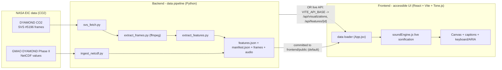

# Listen to Earth — The Earth Information Jukebox

[](https://www.spaceappschallenge.org/2026/challenges/the-earth-information-jukebox/)
[](https://www.spaceappschallenge.org/2026/find-a-team/ai-minds/)
[](https://mmoneka11.github.io/Listen-to-Earth/)
[](LICENSE)

> **Listen to Earth** turns **NASA Earth Information Center (EIC)** visualizations into sound,
> in real time, so sighted, blind, and low-vision users can *hear* our changing planet.

**Live app:** https://mmoneka11.github.io/Listen-to-Earth/ · **Demo video:** https://youtu.be/yaHms5RT0PA · **Repo:** https://github.com/mmoneka11/Listen-to-Earth

---

## Dataset — real NASA data

Built on one real NASA dataset, in two forms (both genuinely used, not synthetic):

| Data | Source | Used as |
| :--- | :--- | :--- |
| **DYAMOND Global Carbon Dioxide** | NASA SVS **#5196** — https://svs.gsfc.nasa.gov/5196 | 314 real animation frames → features → sound |
| **DYAMOND Phase II CO₂ (gridded)** | NASA **GMAO / NCCS** NetCDF | real data values → sound (offline render) |

The committed files `frontend/public/manifest.json`, `features/co2.json` (314 real frames,
with captions), `frames/co2/*.jpg`, and `audio/co2.wav` are produced by the backend pipeline
from the NASA source above. The app loads and plays **this real data** — it only shows
clearly-labeled fallback data if the real files cannot be loaded (and then it displays a red
"fallback data" warning so real vs. synthetic is never ambiguous).

## How frontend & backend connect



The frontend consumes the backend's **data contract** (`manifest.json` + `features/<id>.json`).
Two connection modes, both using the same real data:
- **Default (static):** the frontend reads the backend's committed output from `public/`. This is
  what deploys free on GitHub Pages — no server to keep running during judging.
- **Live API:** set `VITE_API_BASE` to a running backend (`backend/serve_features.py`, e.g. on
  Render/Railway). The frontend then calls `/api/visualizations` and `/api/features/co2` live.

Per-frame contract: `{ i, hue, brightness, hot, panX, delta }` → hue = note (C-major pentatonic),
brightness = octave/volume, hot = rhythm, panX = stereo pan, delta = accent, over a C2 sub-drone
with a limiter. Same mapping in the browser (`frontend/src/utils/soundEngine.js`) and offline
(`backend/sonification/engine.py`).

## Repository layout

```
Listen-to-Earth/
├── frontend/            # React + Vite accessible UI (static; reads real NASA data)
│   └── public/          # committed NASA frames, features.json, manifest.json, audio
├── backend/             # data pipeline + sonification engine + FastAPI data API
│   └── sonification/    # engine.py + engine.ts + mapping_config.json + real renders
└── .github/workflows/   # ci.yml (tests) + deploy.yml (GitHub Pages)
```

## Deployment (free, GitHub Pages)

The `Deploy` workflow builds the frontend (with the correct base path) and publishes it on every
push to `main`. Enable it once: **Settings → Pages → Source → GitHub Actions**. Paths are
base-aware, so the app works at `https://mmoneka11.github.io/Listen-to-Earth/`.

## Run locally

```bash
# Frontend (accessible UI) — uses the committed real NASA data
cd frontend && npm install && npm run dev        # http://localhost:5173

# Backend — rebuild the data and/or serve the live API
cd backend && pip install -r requirements.txt fastapi uvicorn
python build_all.py --audio                      # rebuild CO2 data from NASA + render audio + verify
python serve_features.py                         # http://127.0.0.1:8000  (landing page, /api, /public)
# to connect the frontend to this live API:  set VITE_API_BASE=http://127.0.0.1:8000 before npm run dev
```

## Accessibility

Sonification **is** the access feature; plain-language captions (generated from the data) are
announced via `aria-live`; full keyboard control (Space/Esc/R/←/→/1–3); high contrast and
`prefers-reduced-motion`. See `backend/ACCESSIBILITY.md`.

## NASA data & credits

- DYAMOND Global Carbon Dioxide — NASA SVS #5196 — https://svs.gsfc.nasa.gov/5196
- NASA Earth Information Center — https://earth.gov
- GMAO DYAMOND Phase II — https://gmao.gsfc.nasa.gov/gmao-products/dyamond-phase-ii/data-access_dyamond-phase-ii/
- NCCS DYAMOND v2 data share — https://portal.nccs.nasa.gov/datashare/G5NR/DYAMONDv2/03KM/

Credit: *NASA Scientific Visualization Studio* and *NASA GMAO*. Tools: React, Vite, Tone.js,
Python, NumPy, Pillow, ffmpeg, FastAPI, xarray/netCDF4.

**SI / AI disclosure:** project code and documentation were written with AI assistance
(Anthropic Claude). All NASA data processing, the sonification mapping, and the generated audio
are deterministic outputs of our own code — **not AI-generated audio**. No NASA branding was
generated or modified; AI-generated imagery (team banner) is watermarked.

## Team AI-MINDS

| Member | Role | Contribution |
| :--- | :--- | :--- |
| **Sobia Sattar** | Team Lead | Project coordination, challenge research & submission |
| **Moneka Meghwar** | AI Developer | Sonification engine, data/AI & project documentation |
| **Sumera Shar** | Presentation Lead | Presentation, storytelling & demo |
| **Muhammad Azfar** | Frontend Developer | React/Vite UI & accessible components |
| **Daya Nand** | Frontend Developer | React/Vite UI & interaction |

## License

Apache-2.0 (`LICENSE`) — the NASA Space Apps default.
